<div align="center">


# Defense

**An offline study companion for a PhD defense, on iPhone, iPad and Mac.**

Flashcards, quizzes, formulas with plots, and a browsable graph of terms —
compiled from a research vault, scheduled by FSRS, no network.

<sub>iOS 26 · Mac Catalyst (macOS 26) · Swift 6 · SwiftUI + SwiftData + Swift Charts · zero dependencies · MIT</sub>

</div>

---

| Today | A law, with its shape | Structure, drawn |
|---|---|---|
| 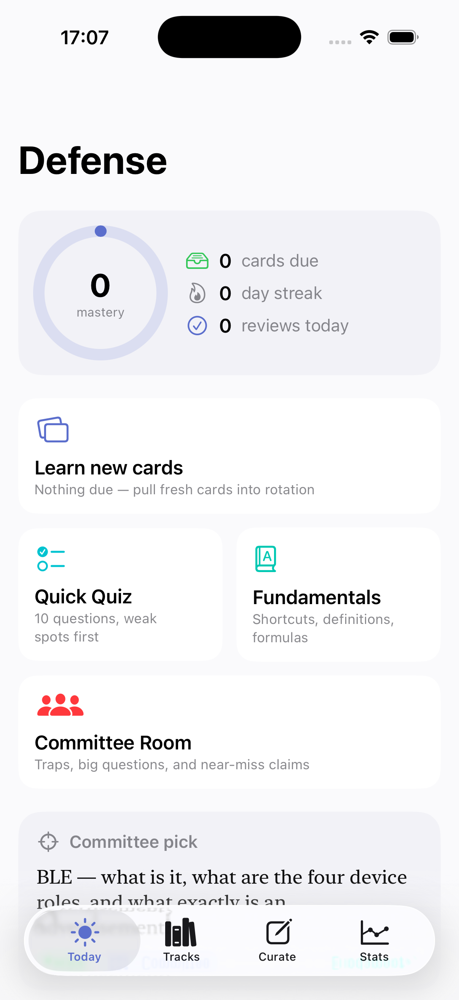 | 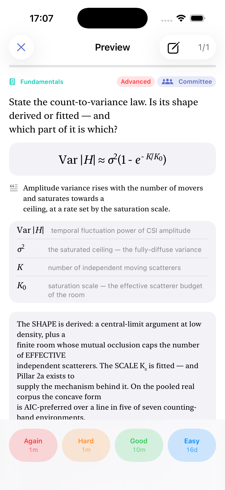 | 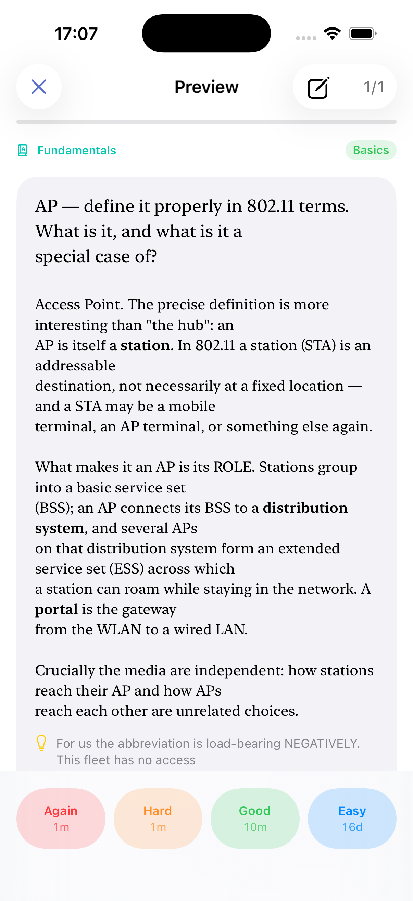 |

| Real measured data | Where a term leads | Dark |
|---|---|---|
| 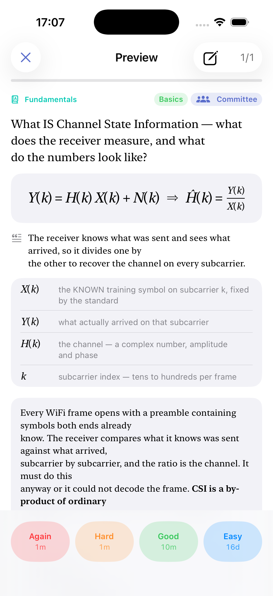 | 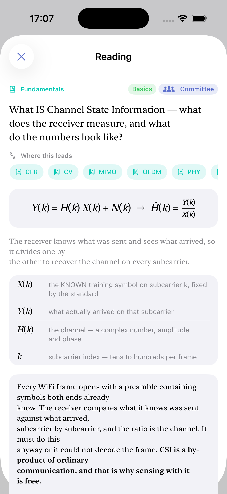 | 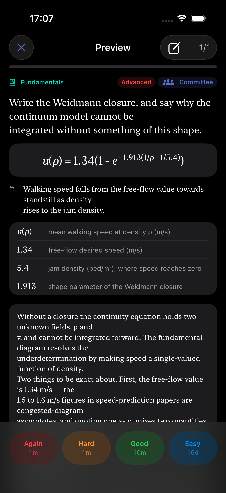 |

---

## What it is

A personal, single-user app. It holds the vocabulary, the laws, the hypotheses
and the committee traps of one thesis, and it drills them on a spaced-repetition
schedule until they are available under pressure.

- **No analytics, no account, no third party.** Content ships in the app
  bundle; progress lives on-device in SwiftData. The only network is your own
  Desk server, when you set one up: banks, the Library, and sync between your
  devices.
- **No third-party dependencies.** The maths typesetter, the figure renderers
  and the FSRS scheduler are all in this repo — 4,400 lines of Swift.
- **Content is compiled, not written here.** Cards come from Obsidian deck notes
  in the parent research repo, via one explicit command.

It is published because the app is a reusable thing and the pipeline behind it
is worth reading, not because it is a product. There is no roadmap, no release
and no support. See [Scope](#scope).

## Cards

Three kinds, all in one FSRS queue.

| kind | what it asks |
|---|---|
| `flash` | front → back, graded Again / Hard / Good / Easy |
| `mcq` | one right answer; distractors are **intentionally false near-miss claims**, several encoding documented mis-citation traps |
| `formula` | state the law — reveal shows it typeset, a symbol table, and a plot of what it *does* |

Every card kind can carry figures, and every card can link to other cards.

A trap card, revealed — the wrong option has to be *tempting* to do its job:

<div align="center">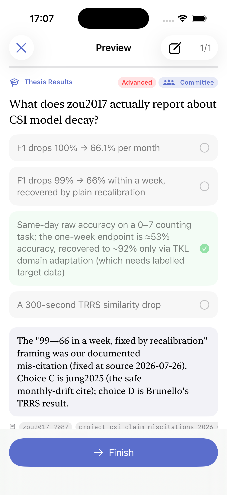</div>

### Figures

Five kinds, one list per card, discriminated by `kind`.

| kind | what it is for |
|---|---|
| `plot` | curves **sampled at compile time**, so the app needs no expression evaluator |
| `diagram` | labelled nodes and edges on a normalised canvas, drawn with native shapes |
| `image` | a bundled raster — the one case the others cannot serve: what real measured data looks like |
| `table` | values that are a list rather than a shape; never scrolls sideways |
| `sequence` | actors and the ordered messages between them, laid out from the order |

| Interactive plot | Table | Sequence | Diagram |
|---|---|---|---|
| 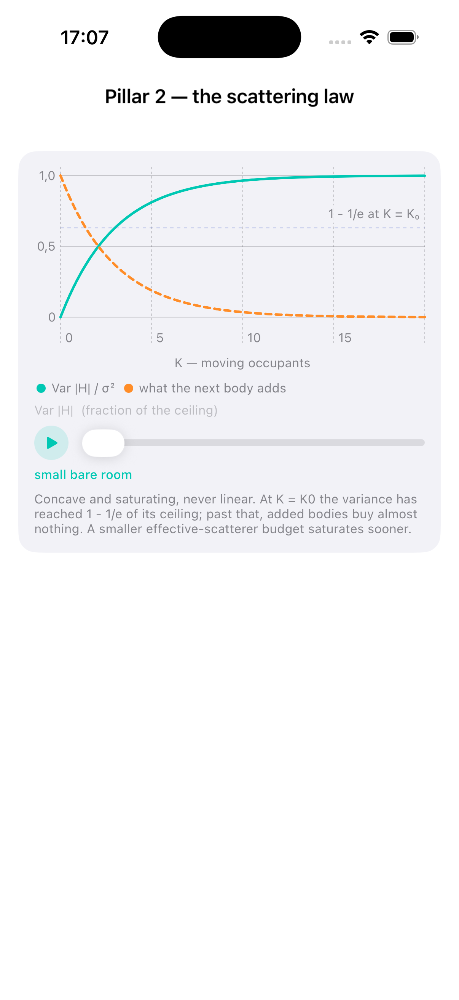 | 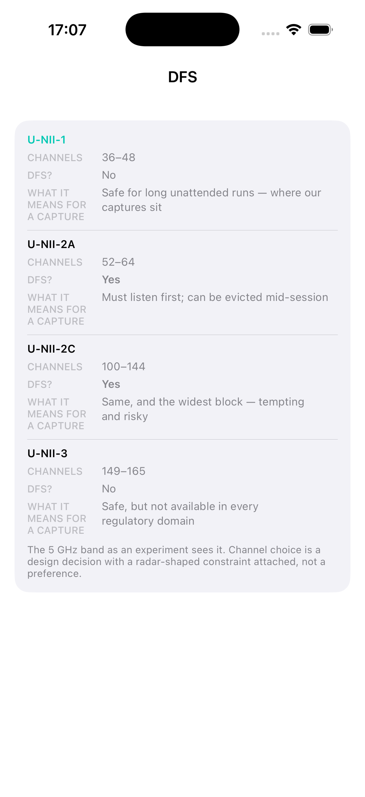 | 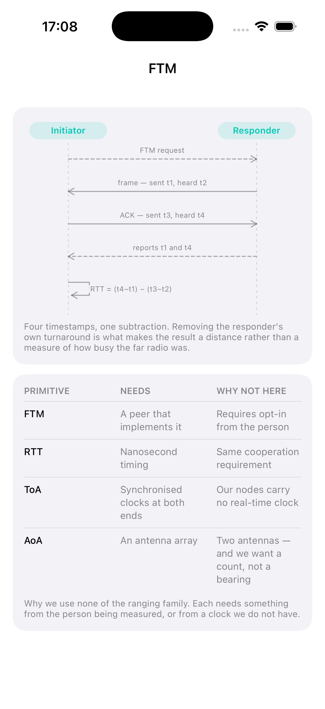 | 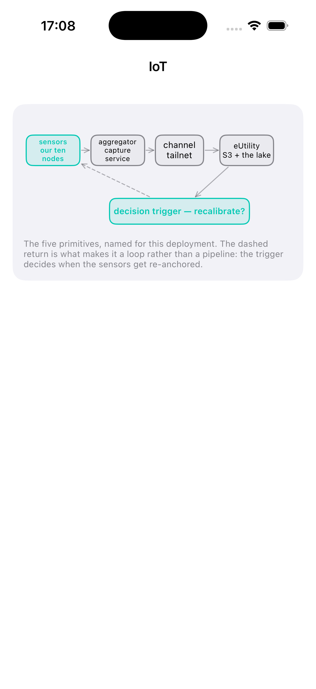 |

Nothing but `image` is a raster, so every figure scales with the reader's type
size and is correct in dark mode by construction. A `plot` may declare a swept
**parameter**: the compiler samples one frame per value, and the app scrubs
between them. Interactivity therefore costs the phone nothing, and the slider
can only land on a state the author chose to show.

An unknown `kind` renders as a placeholder rather than failing to decode, so a
bank compiled by a newer pipeline degrades instead of crashing at launch.

Full field-by-field reference: [docs/DECK-BANK.md](docs/DECK-BANK.md).

### The card graph

Terms do not live alone. A card declares `see_also:` and the compiler makes
every link **symmetric**, so there are no one-way streets — from CSI you reach
OFDM, and from OFDM you can walk back.

Following a link opens a read-only reader, which can be walked onward to any
depth. It deliberately does **not** grade the card or move it in the queue:
curiosity must not corrupt the schedule.

### Maths

`Views/MathTypeset.swift` parses a restricted LaTeX subset — greek, `\frac`,
`\sqrt`, sub- and superscripts, `\sum` with limits, accents, `\mathrm`,
`\mathbf`, the usual relations — into a node tree laid out with SwiftUI.
Fractions and big operators sit on the maths axis, not the text baseline. A long
formula shrinks to fit before it becomes a horizontal scroller.

Anything it cannot parse falls back to the raw source in monospace. A formula
that renders as its own LaTeX is ugly; one that crashes the session is worse.

## The Thesis tab

A guided walk through the mathematics of the thesis: 6 modules, 97 steps, every
equation symbol by symbol, every thesis figure with how to read it, and 28
native interactive widgets (Swift Charts, no evaluator, no network). It starts
at school level (slopes, logarithms, complex numbers as arrows) and ends at the
resolution horizon and the two bounded negatives. Steps are read, not graded:
the tab never touches the FSRS queue. The same vault notes render the Slidev
decks in the parent repo's `publications/thesis-math/`. See
[docs/CONTENT.md](docs/CONTENT.md#the-thesis-guide-thesis-tab).

## Content

Content is not written here. It is compiled from vault deck notes into
`MonadDefense/Resources/DeckBank.json` plus a `Figures/` directory, by an
explicit command in the parent repo — never by a build phase:

```bash
uv run monad-knowledge edu deck spine --apply   # re-render the RQ deck
uv run monad-knowledge edu deck validate        # anchors and figures must resolve
uv run monad-knowledge edu deck compile         # → DeckBank.json + Figures/
```

Then rebuild.

Review progress is keyed by **stable card ids** and survives a content update; a
card whose id disappears is orphan-pruned at next launch. Keeping the refresh
out of the build keeps the build fast and offline, at the cost of a stale bank
being invisible — so the app states its content's age on the Today screen once
it passes a threshold.

The **Curate** tab closes the loop the other way: sweep the bank with the
answers open, one verdict per card (`keep` / `more` / `fix` / `cut`) plus a note,
export as JSON, and map the verdicts back onto the deck notes that own each card.

Since IP-151 every pass here is a **swipe stack** (`Views/Triage/TriageDeckView`),
one gesture grammar for every use: right = yes, left = no, up = rework with a
note, hold = the rare fourth verb, tap = flip. Three stacks ship:

| Stack | Decides | Right / left / up land as |
|---|---|---|
| Curation pass | card quality | `CardNote` → `monad-defense/curation/1` → `edu deck curation` |
| **Dwell review** | does this card's `dwell:` text belong on a participant's phone (monad-app) | `TriageDecision` → `monad-defense/triage/1` → `edu deck select` → `edu/decks/dwell-selection.md` |
| **Eggs** | is the instance an easter egg | same export → the card's `wtf` tag |

The Dwell review card is a mock of the monad-app panel at phone width with the
11 s bar running, because the judgement is about the phone. A card the vault
already accepted comes back **stale-first** when its text was edited after the
swipe — the digest in the selection note no longer matches — and it is off the
phone until swiped again.

Both loops: [docs/CONTENT.md](docs/CONTENT.md).

### Provenance

Cards carry two provenance fields, rendered as distinct chips.

- **`anchors`** — validated knowledge-base identifiers: argument-chain links
  (`<chapter>.<slug>`) and hypothesis slugs, the same identifiers the thesis's
  `\kb…` LaTeX macros carry. An unresolvable anchor fails validation.
- **`sources`** — free-form provenance. Never validated.

The **research-question deck is generated, not written**: it is rendered from
the same declaration the thesis itself renders from, so a rehearsed question
cannot drift from the asked one.

## On a Mac

One target runs on iPhone, iPad and Mac (Catalyst with the Mac idiom). The
iPad comes with the Mac: Catalyst requires the iPad device family. On a wide
window the tabs become a sidebar and the Library becomes a split view. Swipes
become keys.

| Where | Keys |
|---|---|
| Every swipe stack (Desk, dwell, eggs) | → right · ← left · ↑ up · ↓ fourth verb · space expand · N note · ⌘Z undo · esc close |
| Note sheet | ⌘↩ commits the note |
| Study session | space reveal · 1–4 Again / Hard / Good / Easy · 1–n MCQ option by shown number · ↩ next · esc close |
| Curate, Library | ⌘R refresh (no pull-to-refresh under a pointer) · ⌘F search (Library) · ⌘S save a locked session's file |
| Anywhere | ⌘1 Curate · ⌘2 Library · ⌘3 Defense · ⌘, Desk server |

Keys go dead while a sheet is open, so an arrow pressed in the note sheet
never decides the card behind it. Bare-letter and arrow keys are Mac-only: on
a phone a paired keyboard nobody expects to be live must not decide a card.

## Sync between devices

Every device with a Desk server set up shares its history through that
server (`/api/sync`): Desk sessions and decisions, study reviews and finished
sessions, and swipes. It runs on launch, on return to the app, every five
minutes in front, after a sitting closes, and from **Sync now** in Curate. No
third party is involved; without a server the app works alone as before.

The server stores each device's batches as sent and merges nothing. Every
device unions what it reads by record identity, so a pass can repeat or break
off without harm (`Models/SyncModels.swift` holds the merge rules):

- **Reviews, not schedules.** FSRS progress never travels. A card's schedule
  is replayed from its merged review log, so reviews done offline on two
  devices both count, in time order.
- **A Desk session belongs to the device that opened it.** Only that device
  adds decisions to it, locks it or sends it; elsewhere it shows read-only
  with an "on iPhone" badge. Its decisions still count: a sitting on the Mac
  shows only the cards no device has decided yet.
- **Swipes: the newest wins**, and clearing a swipe is a dated tombstone, so
  an older swipe arriving late cannot bring it back.

Two devices that decide the same Desk task while both are offline send two
decisions; the vault's ledger decides which one counts, as it always has.

## Build

```bash
xcodebuild -project MonadDefense.xcodeproj -scheme MonadDefense \
  -destination 'generic/platform=iOS Simulator' build
xcodebuild -project MonadDefense.xcodeproj -scheme MonadDefense \
  -destination 'platform=macOS,variant=Mac Catalyst,arch=arm64' build
```

Or open `MonadDefense.xcodeproj` in Xcode 26+ and pick "My Mac (Mac Catalyst)"
or a simulator. A simulator build needs no configuration. A Mac build needs a
signing team (see below): the Desk token lives in the data-protection
keychain, which an unsigned build cannot write.

To sign for a device, copy `Configuration/Local.xcconfig.example` to
`Configuration/Local.xcconfig` (gitignored) and put your team id in it.

Files under `MonadDefense/` are included automatically — the project uses a
hand-authored `project.pbxproj` with `PBXFileSystemSynchronizedRootGroup`, so
adding a source file or a resource needs no project edit.

More, including the screenshot pipeline and the conventions:
[docs/DEVELOPMENT.md](docs/DEVELOPMENT.md).

## Documentation

| | |
|---|---|
| [docs/ARCHITECTURE.md](docs/ARCHITECTURE.md) | the four layers, the two stores, FSRS, figures, the graph |
| [docs/DECK-BANK.md](docs/DECK-BANK.md) | `DeckBank.json` field by field — the contract with the compiler |
| [docs/CONTENT.md](docs/CONTENT.md) | the authoring loop and the curation loop |
| [docs/DEVELOPMENT.md](docs/DEVELOPMENT.md) | build, signing, layout, conventions, screenshots |

## Design

The mark is a sibling of the `monad-app` icon: the same M in ink navy
(`#0F142F`), the same three arcs in periwinkle (`#5B6ECC`). monad-app's arcs
radiate outward — a measurement leaving. These are mirrored to open toward the
M, and the accent roles are swapped, so the two read as a family while staying
distinguishable at dock size.

Sources are in `design/` as hand-authored SVG; `Views/Theme.swift` carries the
same palette for the places the asset catalogue cannot reach.

## Scope

This is one researcher's instrument, published for reading rather than for use.

- **No support and no issue triage.** Fork it if it is useful.
- **No tests.** A stated gap: `FSRS` and the `MathTypeset` parser are the two
  pieces that would repay a test target, and neither is covered.
- **Single user by construction.** Sync joins one person's devices through
  one Desk server and one token. There are no profiles and no accounts.
- **The compiler lives elsewhere.** This repo cannot regenerate its own content;
  it can only render a bank somebody else compiled.

## Licence

The **software** is MIT — see [LICENSE](LICENSE).

The **study content** is not. `MonadDefense/Resources/`, and the screenshots
that show card faces, are the text and the measured results of a doctoral thesis
in progress. They ship here so the app is legible and reproducible, and all
rights to them are reserved.

Reuse the app; recompile it against your own bank.
